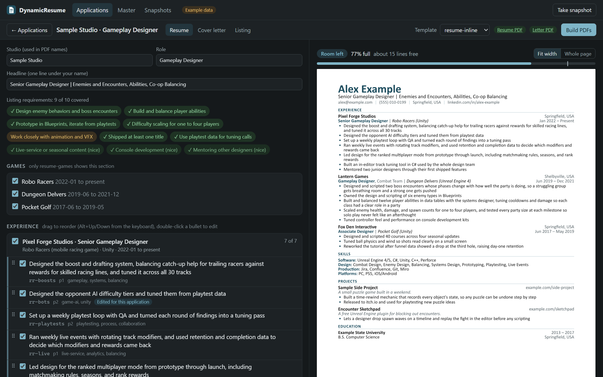
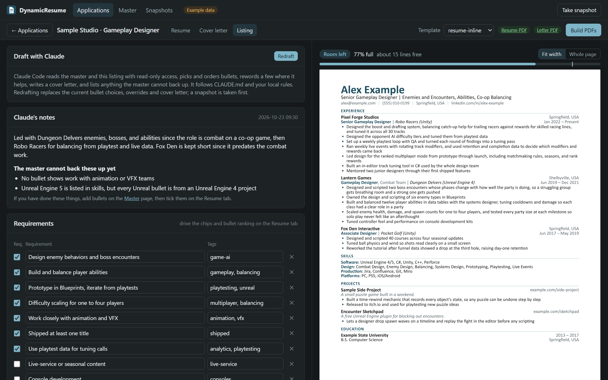

# DynamicResume

Keep all of your career history in one master file, then build a tailored one-page resume and a matching cover letter for each job in a few minutes. Paste a job listing, let Claude Code pick and order the bullets that match it, fine-tune the result in a local editor with a live page preview, and export PDFs that read cleanly in applicant tracking systems.

Built with [Typst](https://typst.app) and a small Python app. No server, no account: everything runs on your machine, and your data stays in gitignored files.

**[See the project page](https://jacobpoteet.github.io/DynamicResume/)** for a quick tour and a live demo.



## Why

A strong resume for one job is a weak resume for another. Reordering bullets, rewording a line to match a listing's language, and trimming to one page by hand takes an hour per application and tends to drift: the wording you improved for one job never makes it back to the others.

DynamicResume splits the work in two:

- **One master file** (`data/master.yaml`) holds every position, bullet, skill and project you could ever show, more than fits on a page. Each bullet has an id, tags and a priority.
- **One small tailor file per job** (`applications/<studio>-<role>/tailor.yaml`) only says which bullets to show, in what order, plus any rewording for that listing. The master is never edited for one application.

Improving a bullet in the master improves it everywhere, and every application stays a few lines of YAML you can rebuild at any time.

## Features

**Drafting with Claude.** Paste a listing under New application and choose Create and draft with Claude. The app runs Claude Code headlessly in the repo with read-only tools. It reads the master and the listing, picks and orders bullets, writes a headline and a cover letter, breaks the listing into requirements, and lists anything the master cannot back up. Every bullet id it returns is checked against the master before anything is written.

**Requirement coverage.** Each requirement from the listing becomes a chip on the Resume tab, green when a selected bullet backs it up. Unselected bullets are ranked by how well they match the listing, so filling a gap is one click.



**A live editor.** Tick bullets on and off, drag them into order, double-click to reword one for this application only, switch templates, and edit the cover letter, with the PDF preview rebuilding as you go. A fill meter shows how full the page is and how many lines are free.

**One page, enforced.** Every build reports the page count and how full the last page is. When a resume runs over, it says about how many lines to cut. The template measures every bullet, so the editor shows each one's line count and flags bullets whose last line is nearly empty, where trimming a few words saves a whole line. It also warns when a role line or the headline wraps. The fix is always to cut or reword, never to shrink the font.

**Short versions and variants.** A master bullet can carry a `short:` wording that any application switches on with one click, instead of pasting the same shorter override into several applications. A bullet marked `variant_of` another is an alternative version of it (say, one that mentions machine learning for the listings that ask). The editor unticks one when you tick the other, and the build refuses both.

**Impact check.** After every master save, the app rebuilds each application into `build/check/` and lists the ones whose page count or fill changed, so lengthening a bullet or renaming a game never pushes one to two pages unnoticed. `python build.py check` does the same from the command line.

**Recurring gaps.** Each draft lists what the listing asks for that your master cannot back up, with a short topic. Master, Gaps ranks those topics across every application, so you know which bullets are worth writing next.

**Studio notes.** Notes about a studio (games of theirs you've played, people you know there) live in `data/studios.yaml`, are edited on the Listing tab, and go into the draft for the cover letter.

**Writing lint.** Builds flag em dashes and filler phrases ("leverage", "passionate about", "spearhead" and others) in resume and letter text.

**ATS-friendly output.** Single column, real text, standard section names, no icons, and each role's company repeated so autofill parsers never mistake a team name for an employer. Template changes are checked with `pypdf` text extraction. PDFs carry a title and author, and contact and project URLs are links.

**Matching cover letters.** Write paragraphs in Markdown. The letter shares the resume's header, colors and margins.

**Submitted applications stay as sent.** Once you send an application, choose Mark submitted. The PDFs are frozen exactly as they are, with the tailor, letter, listing and master that made them, in the application's `submitted/` folder. Builds skip it, the app opens it read-only and shows the PDFs you sent, and the master is free to change without touching it. When a studio calls you back, you can open the resume they actually have. Unsubmit makes it editable again.

**Application tracking.** The home page is a board: Drafting, Applied, Screen, Interviewing and Offer, with Rejected, Ghosted and Withdrew trays underneath. Drag a card to its next stage and say when it happened (today, yesterday, or any date), when the call or interview is scheduled, and a note. Interview rounds record the format, length, interviewers, prep notes and a debrief. Moving a draft to Applied marks it submitted. A card with nothing logged or scheduled for 30 days asks whether you were ghosted, which counts as a rejection but stays out of time-to-rejection. Click a card for its full history, where any entry can be edited or deleted. Timeline draws every application across the calendar, and Stats shows the reply rate, days to first reply and to rejection, how far applications got, applications per week and what is coming up. Each application's history is a plain `tracking.yaml` in its folder.

**Safe editing.** The app writes YAML with round-trip formatting, so comments and layout in your files survive. Every master save keeps the previous version, the app refuses to delete a bullet an application still uses, and snapshots zip everything before a redraft or delete. Edit the files in a text editor or with Claude at any time; the app notices within a couple of seconds and reloads.

## Quick start

You need Python 3 and the Typst CLI.

```
winget install Typst.Typst
pip install -r requirements.txt
```

Try it on the fictional demo data in `examples/`:

```
python build.py --example serve
```

That opens the editor at http://127.0.0.1:8765 with a sample application already drafted. Build PDFs writes the resume and cover letter into the application folder.

Drafting needs [Claude Code](https://claude.com/claude-code) installed and signed in (`claude` on your PATH). It uses your Claude Code login, so there is no API key to set up. Without it, the app still works; you pick the bullets yourself.

## Using it for real

1. Copy `examples/data/master.yaml` to `data/master.yaml` and replace it with your own history. Write more bullets than fit on a page, tag them, and give the strongest ones priority 1.
2. Run `python build.py serve`. Paste a job listing under New application and choose Create and draft with Claude.
3. Review the draft: check the requirement chips, swap bullets, reword where it helps, and fill the page.
4. Build PDFs, then check the build output says one page for both files.
5. After you send them, choose Mark submitted so later master changes never rebuild what the studio has.
6. When you edit the master, read the impact panel (or run `python build.py check`) before building.

Run `python build.py build master` to render the whole pool on several pages with each bullet's id, priority and tags, which makes the master easy to review.

You can also tailor without the app: `python build.py new "<studio>" "<role>" --listing listing.txt` makes the folder, and `python build.py draft <studio>-<role>` runs the same Claude draft the app does and builds the PDFs. Or write `tailor.yaml` and `cover-letter.md` yourself (copy them from `examples/applications/`) and run `python build.py build <studio>-<role>`.

If you develop in git worktrees, the code in a worktree reads and writes the main checkout's `data/`, `applications/`, `Local/` and `snapshots/`, so there is one copy of your data. Set `DYNAMICRESUME_HOME` to keep it somewhere else.

Personal rules for Claude, such as how to describe a project you can't name or which jobs to leave off, go in a gitignored `CLAUDE.local.md` at the repo root. Drafts follow it alongside `CLAUDE.md`.

## Commands

```
python build.py serve                 # editor app at http://127.0.0.1:8765
python build.py build <app-folder>    # one application, by name under applications/ or a path
python build.py build master          # the full pool, with ids, priorities and tags
python build.py build-all             # every application except submitted ones
python build.py check                 # rebuild everything into build/check/ and report page changes
python build.py new "<studio>" "<role>" [--listing file|-]   # start an application
python build.py draft <app>           # draft it with Claude Code, then build
python build.py snapshot [label]      # zip the master, applications and templates into snapshots/
python build.py submit <app> [--date YYYY-MM-DD]   # freeze the PDFs as sent; builds skip it from then on
python build.py unsubmit <app>        # make a submitted application editable again
python build.py track <app> [stage] [--date --note --scheduled --format --length --with "Name, Role"]   # log or show its history
```

Add `--example` to any command to use `examples/` instead of your own data. `build <app> --template <name>` tries another template without changing the application (the trial PDF goes to `build/<app>/`).

## How it works

```
data/master.yaml ─┐
                  ├─ build.py ─ resolved JSON ─ Typst template ─ PDF
tailor.yaml ──────┘   (merge, override, lint, measure the page)
```

`build.py` merges the master with an application's tailor file, applies overrides, lints the text and writes resolved JSON into `build/`. The Typst template reads that JSON and lays out the page, then ends with a metadata label (page count, where the content ends, the usable area) that `build.py` queries to report the fill.

The editor in `studio/` is a standard-library Python HTTP server bound to 127.0.0.1, with one HTML page of plain JavaScript and CSS and no build step. The app and the command line read and write the same files, so either works at any time.

## Templates

| Template | Layout |
|---|---|
| `resume-inline` (default) | Roles grouped by company, each game named on its role line |
| `resume-games` | Roles grouped by company, plus a Games section with one line per title |
| `resume` | The original layout with a gray header band |

Pick one with `template:` in `tailor.yaml` or the Template menu in the app. Fonts fall back from Calibri to Arial to Typst's built-in serif; change them in `templates/timeline.typ` (`common.typ` for `resume`).

## Project layout

```
build.py               merge, lint, compile, page fill
studio/                the editor app (server, Claude drafts, workspace and snapshots)
templates/             Typst resume and cover letter templates
examples/              fictional demo master and application
tests/, scripts/       pytest suite and the privacy check, run by CI (.github/workflows/ci.yml)
docs/                  the GitHub Pages project page (plain HTML, CSS and JS) and README screenshots
CLAUDE.md              schemas and the tailoring workflow, written for Claude and for you
data/, applications/   your master and applications (gitignored)
snapshots/, build/     backups and build output (gitignored)
```

The full `master.yaml`, `tailor.yaml` and `listing.yaml` schemas are in [CLAUDE.md](CLAUDE.md).

## Checks

GitHub Actions runs four jobs on every pull request and push to `main`, all on the fictional demo data:

- **Syntax and lint:** `ruff` on the Python, `node --check` on the app's JavaScript.
- **Privacy guard:** `scripts/check_privacy.py` fails if a tracked file, or the text inside a demo PDF, holds personal-looking data. That covers anything under `data/`, `applications/`, `Local/`, `snapshots/` or `build/`, `CLAUDE.local.md`, a PDF outside `examples/`, a real email address or phone number, or an absolute path into a home folder. Add a repository secret named `PRIVATE_TERMS` (your name, employers, comma separated) and it fails on those too, without the terms ever appearing in the repo or the log. Phrases that are public on purpose, such as the author credit on the project page, go in `scripts/public-terms.txt`; the check removes them before matching, so a surname or employer on its own still fails.
- **Unit tests:** `pytest` covering bullet resolution, draft parsing, the data home, submit and unsubmit, application tracking and stats, snapshots, round-trip YAML, studio notes, gaps, and the file server's path checks.
- **Demo build (Windows):** builds the demo with Typst, runs `check` so a resume over one page fails, and reads the PDFs back as an ATS would. That checks the headings, section order, contact details, the company on every role, no em dashes, and that the committed demo PDFs match a fresh build.

Run them locally with:

```
pip install -r requirements.txt -r requirements-dev.txt
ruff check .
python scripts/check_privacy.py
python -m pytest            # the Typst tests skip if typst is not installed
```

## Privacy

This is a public repository. `data/`, `applications/`, `Local/`, `snapshots/`, `build/`, `CLAUDE.local.md` and every PDF outside `examples/` are gitignored, so your career data, applications and personal rules never leave your machine. Anything in `examples/` is fictional.
